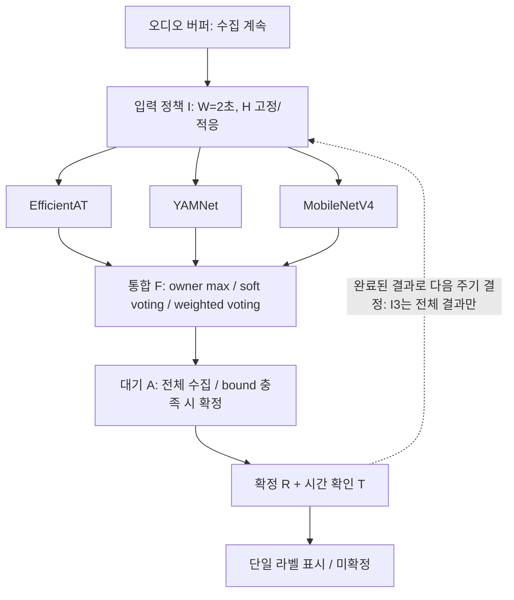

# Latency(+Inference time) 감소를 위한 판단 정책 재설계

2026-10-16 · 첨부 초기 보고서와 현재 구현을 대조한 정책 중심 개정안

## 1. 연구 방향과 유지 조건

사용자가 확인한 기존 최고 성능 방식은 **모델별 전용 라벨 학습 후 담당 점수의 전체 최댓값 선택**이다.
이 방식은 기준군으로 보존하되 최종 구조를 무투표로 제한하지 않는다.
전문 모델을 학습하는 방법과 모델 결과를 결합하는 방법은 별개의 실험 축이다.
같은 specialist checkpoint라도 owner max·평균 soft voting·클래스별 가중 voting을 비교할 수 있다.
본 구현은 현재 제공된 specialist 저장 예측을 재사용하므로 원본 모델을 재학습하거나 덮어쓰지 않는다.

조건: specialist 3개, 단일 라벨 표시, 현재 학습 문맥 2초·기존 갱신 2초,
소리 onset→올바른 표시 2초 이내 목표, Raspberry Pi 5/상한 Jetson Orin Nano.
넥밴드→키링 통신 지연은 제외하고 관찰·전처리·실행 큐·embedding/head·확정을 구분한다.
기존 비동기 실행은 유지 가능한 구조로 설계하되, 논리적 window ID와 실제 입력 구간을 일치시켜 결과를 비교한다.
보여 주는 라벨은 하나지만 내부에서는 모든 후보 점수를 보존한다.

정책은 deterministic 규칙이다. 오프라인의 F1 기반 가중치 계산·threshold 설정은 포함하지만
정책 NN, RL, 모델 내부 early exit는 이번 구현에 넣지 않는다.
이 통계량을 데이터로 설정한다는 사실과 실행 때 고정 규칙을 따른다는 사실을 구분한다.



## 2. 초기 계획을 다시 검토한 변경 사항

| 초기 항목 | 이번 처리 | 이유 |
|---|---|---|
| P1 관찰·실행 주기 | 고정 I0/I1/I2 + 입력 난이도/후보 긴급도에 따른 I3 구현 | 언제 실행할지와 언제 추가 관찰할지 구체화 |
| P2 specialist 내부 계산 종료 | 현재 범위에서 제외 | 사용자 요청에 따라 backbone/중간 출구 변경 없이 정책 효과부터 분리 |
| P3 통합·최종 확정 | F0/F1/F2, R0/R1/R2, T0/T1/T2, 비동기 A0/A1로 분해 | 선택 점수·확정·안정성·미도착 대기를 혼동하지 않음 |
| P4 통계적 정지 보정 | 독립 event 데이터 확보 후 별도 확장 | overlapping clip 재분할만으로 기존 논문의 보장을 주장할 수 없음 |
| M1 짧은·긴 문맥 | W2초 정책의 후보를 좁힌 뒤 길이별 재학습/검증 | 기존 2초 임베딩을 잘라 짧은 관찰이라고 해석하지 않음 |
| M2 부분 구간 학습 | 사건 포함 여부/onset 주석을 먼저 확보 | 양성 clip의 모든 crop에 양성 라벨을 붙이는 오류 방지 |
| M3 내부 early exit | 별도 모델 실험으로 보류 | 조기 출력과 계산 생략은 다름 |
| M4 전문 클래스 재분류 | 정책 인터페이스와 배정을 분리, 후속 G0/G1/G2 계획 유지 | 재배정 효과와 정책 효과를 각각 비교 |
| M5 배경·비담당 거부 학습 | 정책 결과에서 취약 라벨·오탐을 분석한 뒤 head/학습 개선 | threshold만으로 upstream 혼동을 해결할 수 없음 |

### 핵심 고려 사항 → 실제 방법론

| 고려 사항 | 연결 방법 | 확인할 결과 |
|---|---|---|
| 모델마다 다른 과신·비담당 점수 | F0/F1/F2 비교, fusion마다 R threshold 별도 설정 | 실제 최종 라벨·라벨별 오류; 단순 점수 크기 비교 금지 |
| 짧은 소리와 지속음의 차이 | T1 공통 2회 확인 대비 T2 차등 확인 | 단발음 미검출·추가 대기·표시 교체 |
| 실제 입력이 쉬운지 어려운지 | I3 confidence/margin·후보 긴급도 규칙 | 호출 수를 줄이면서 2초 내 정답 비율 유지하는가 |
| background/unknown/미확정 | background 후보·threshold 거부를 별도 기록 | 오경보와 과도한 거부의 분리 |
| fire_alarm·knock 출력 소실 | R2의 명시적 recall backoff + 실패 원인 기록 | 정밀도 목표 완화의 비용, upstream 분류 오류 |
| 미도착 specialist 대기 | A0 전체 대기 vs A1 완료 가능 결과의 상·하한 확인 | 전체 voting과 동일한 판단을 더 일찍 확정하는가 |
| 장치 처리량·큐·오래된 결과 | 서비스 시간 기록, FIFO 모의실험, 오래된 입력 출력 차단 | 갱신 단축이 큐 지연을 늘리지 않는가 |
| 재분류 이후 확장 | expert_classes, head 순서, checkpoint 경로를 외부 spec으로 보존 | 동일 정책을 새 모델에 이전·재설정했을 때의 변화 |

## 3. 결합 정책 F: 무투표와 voting을 같은 모델로 비교

| 코드 | 방법 | 구체 규칙 | 학습 모델 변경 |
|---|---|---|---|
| F0 | 담당 라벨 max | 라벨 c에는 담당 모델 p_owner(c)(c)만 사용 | 없음 |
| F1 | 평균 soft voting | q_c = (1/M) Σ_m p_m(c) | 없음 |
| F2 | 클래스별 가중 soft voting | r_c = Σ_m w_mc p_m(c), q_c=r_c/Σ_j r_j | 없음; weight만 오프라인 계산 |

F0의 담당 점수는 모은 뒤 재정규화하지 않는다.
F1/F2는 specialist의 **비담당 라벨 출력도** 활용하므로 다른 모델의 보완 가능성과 과신 손해를 함께 검증한다.
F0는 background=global_max를 기본 비교 가정으로 기록한다. 과거 무투표 서비스의 정확한 background 경로로 확인된 값은 아니다.
F1/F2의 background는 다른 클래스와 같은 voting 규칙을 적용한다.
따라서 F 비교는 background를 포함한 전체 통합 규칙의 비교다. 같은 foreground 수식만 비교하는 실험이라고 과장하지 않는다.

F1의 예측 확률 평균은 [Deep Ensembles, NeurIPS 2017의 2.4절](https://proceedings.neurips.cc/paper_files/paper/2017/file/9ef2ed4b7fd2c810847ffa5fa85bce38-Paper.pdf)의 결합 원리를 참고한다.
원 논문은 일반적인 독립 학습 ensemble을 다루며, 현재 이질적인 specialist 조합의 성능·보정을 보장한 것은 아니다.

F2는 특정 논문의 최적해라고 주장하는 대신, 원 프로젝트의 다음 계산식을 대조 가능한 기준으로 유지한다:

`a_mc = max(F1_mc, 0.05)^2 × (담당 라벨이면 1.25, 아니면 1)`

`w_mc = a_mc / Σ_m a_mc`

기존 F/G weight 파일을 그대로 재사용하지 않고 이번 fusion-fit group에서만 산출한다.
0.05/2/1.25는 원 프로젝트를 따르는 고정 비교 설정이지 논문이 증명한 최적값이 아니다.
전용 head의 softmax는 **native 전체 head에서 계산한 뒤** 라벨 순서를 맞춘다.

### 서로 다른 전용 head일 때의 제한

제공된 학습 소스는 background 포함 14-class head라 F1/F2 비교가 가능하다.
실제 최고 성능 run이 각자 전용 subset만 출력한다면 F1/F2를 바로 적용할 수 없다.
출력하지 않는 클래스를 0으로 채우거나 서로 다른 조건부 확률을 같은 전역 확률로 취급하지 않는다.
새 코드는 이런 head 조합에서 명시적으로 오류를 낸다.
해결은 공통 class head/타깃 대 비타깃 점수/공통 데이터 보정처럼 별도 검증된 인터페이스를 만드는 후속 모델 실험이다.
단순 temperature scaling만으로 조건부 확률 문제가 해결된다고 가정하지 않는다.

hard voting/다수결은 현재 주 비교군에 넣지 않았다.
서로 다른 담당 라벨만 제시하는 specialist끼리 2/3 합의를 강제하면 구조적으로 전문성을 억제할 수 있다.
모든 head가 공통 label space를 출력할 때에 한해 추가 대조군으로 검토한다.

## 4. 출력 확정 정책 R: S02 문제를 반영한 개정

사용자가 공유한 S02에서는 기존 S2가 fire_alarm을 5 seed 모두 null로 처리했고,
knock·baby_cry에서도 불안정성이 보고되었다. 원본 S02 보고서를 이 환경에서 직접 재검증한 것은 아니다.
이를 근거로 기존 S2를 그대로 채택하지 않고 **R2라는 새 가설**을 별도로 비교한다.

| 코드 | 규칙 | 정밀도 조건을 못 맞출 때 |
|---|---|---|
| R0 | 선택된 사건을 바로 출력 | 거부 threshold 없음 |
| R1 | fusion별 공통 threshold | 공통 설정조차 불가능하면 feasible=false 기록, τ=0 fallback. 목표 달성으로 해석하지 않음 |
| R2 | 라벨별 precision·recall 조건을 함께 확인 | 아래의 명시적 fallback 적용. null로 사건 전체를 차단하지 않음 |

초기 탐색 설정: precision 목표 .95, 최소 출력 20개, 라벨 recall floor .5.
운영 기준이나 안전 보장 수치가 아니다. `--target-precision`, `--minimum-accepted`, `--recall-floor`로 바꾼다.
긴급도·오류 비용에 따라 라벨별 floor를 다르게 실험하려면
`--label-recall-floors recall_floors.json`에 `{"fire_alarm": 0.7, "siren": 0.7}`처럼 지정할 수 있다.
예시 수치는 초기 가설이며 해당 조건의 평가 recall을 보장하지 않는다.

R2의 순서:

1. 충분한 라벨 support가 있으면 precision 목표·recall floor·최소 출력 수를 함께 만족하는 threshold 중 TP가 가장 큰 값을 선택.
2. 불가능하되 공통 threshold에서 recall floor가 충족되면 공통 값을 사용하고 라벨별 precision 미검증으로 기록.
3. 공통 값이 recall까지 낮추면 precision 조건을 완화한 recall backoff를 별도 시도. 정밀도 목표 미달을 숨기지 않음.
4. threshold=0에서도 recall floor가 불가능하면 upstream_recall_limit 상태로 기록하고 추가 거부를 하지 않음.
5. 희소 라벨은 라벨 전용 추정을 피하고 공통 값으로 fallback. 소표본 불확실성과 평가 recall 위반은 별도 기록.

R2는 최고 후보의 확정만 바꾸며 떨어진 1위 대신 2위를 출력하지 않는다.
misclassification된 fire_alarm을 threshold만 낮춰 정답으로 바꿀 수는 없다.
recall 보존을 위해 precision을 완화하면 오경보가 증가할 수 있다. 본 구현의 실제 참고 결과도 그 비용을 보인다.
후속 개발에서는 라벨 긴급도별 recall floor·오경보 비용을 정하되 label score에 임의 가산점을 주는 방식과 구분한다.

## 5. 입력 정책 I: 언제 다시 판단할지

모두 W=2초 고정, 세 모델을 계속 사용한다.

| 코드 | H | 조건 | 상대 호출량 |
|---|---|---|---|
| I0 | 2초 | 기존 고정 | 1배 |
| I1 | 1초 | 고정 | 2배 |
| I2 | .5초 | 고정 | 4배 |
| I3 | .5 또는 1초 | 아래 규칙 | 관측 결과에 따라 변동 |

I3 초기 규칙: 최고점수<.75 또는 1·2위 차이<.2 또는 긴급 후보이면 H=.5초,
그 외 H=1초. 긴급 라벨 기본값은 원 그룹의 siren/fire_alarm/scream/cry/car_horn이며 CLI로 교체한다.
이는 실제 라벨을 미리 아는 규칙이 아니라 **이미 완료된 현재 입력의 후보**를 이용하는 규칙이다.
새 소리를 놓칠 가능성을 줄이기 위해 slow 주기를 우선 1초로 제한하지만 이것이 2초 목표 달성을 보장하지 않는다.
장시간 urgent 후보에서 계속 빠르게 실행하는 비용도 평가한다.
F0의 점수 합이 1이 아니므로 I3의 같은 초기 confidence 기준이 F별 공정한 최적점은 아니다.
처음에는 동일 규칙의 민감도를 보고, 후보를 좁힌 뒤 fusion별 설정을 동일 탐색 예산으로 조정한다.

AdaptiveAudioBuffer는 캡처가 추론 중에도 계속되도록 최대 약 W+base-hop의 원음 ring을 유지한다.
한 logical window의 전체 결과가 완료된 뒤 다음 실행 간격을 정한다.
큰 청크/늦은 결과로 요청 시점을 넘기면 최신 가용 창을 선택하며 건너뛴 grid 수를 기록한다.
정책이 받지 않은 중간 cache 결과를 보고 다음 실행을 정하지 않는다.
이 adapter는 마이크·worker 프로세스를 직접 생성하는 통합 앱이 아니다.

짧은 문맥 W=.5/1초는 아직 구현된 주 비교군이 아니다.
원음 신규 crop과 학습 길이·전처리·임베딩 변경 검증 후 M1/M2 단계로 확장한다.

## 6. 시간 확정 정책 T: 더 관찰할지, 표시를 유지할지

| 코드 | 규칙 | 확인할 문제 |
|---|---|---|
| T0 | R 정책이 허용한 현재 라벨 즉시 표시 | 기본 latency/오경보 |
| T1 | 같은 후보가 2회 연속 허용되어야 표시 | 일률적인 연속 확인이 단발음·2초 목표를 해치는가 |
| T2 | 단발 후보·매우 강한 후보는 즉시, 그 외 2회+.5초 확인; 진입/해제 기준 분리 | 라벨 특성과 실제 입력 난이도 반영의 이득·오경보·안정성 |

T2 초기 transient 가설은 gun/glass_breaking/knock다. 실제 모든 해당 소리가 단발이라고 주장하지 않는다.
strong 조건은 score≥.9 및 다른 클래스와의 차이≥.2이며 논문에서 가져온 최적값이 아니다.
현재 active 라벨의 해제 기준은 max(.2, .8×그 라벨의 진입 threshold)다.
background가 최고면 active를 해제하고, 입력 창보다 2초 초과 늦은 결과는 T2에서 거부한다.
이는 결과 갱신 시점의 상태 기계로, 결과 자체가 끊겼을 때의 앱 타이머·화면 TTL은 별도 통합 구현이 필요하다.

T1/T2의 반복 확인은 중첩 창이 같은 샘플을 재사용한다. 독립 증거가 2개라는 통계적 주장은 하지 않는다.
H=2초에서 2회 확인은 최소 추가 2초를 만들 수 있으므로 T1은 성능 개선을 가정하는 방법이 아니라 대조군이다.
T2의 강한 오탐 선출력과 이전 라벨 유지 오류까지 표시 변경 로그로 확인한다.

## 7. 비동기 확정 정책 A: 다른 모델을 기다릴지

| 코드 | 규칙 | 구현 범위 |
|---|---|---|
| A0 wait_all | 같은 창의 모든 모델 결과를 받은 뒤 결합 | 기본 회귀·비교 경로 |
| A1 bounded | 미도착 값의 상·하한으로 전체 voting과 동일한 판단이 보장될 때만 먼저 확정 | F1/F2, 고정 I0/I1/I2, T0에 한해 구현 |

평균 voting에서 도착한 모델 집합을 A라 하면:

`L_c = Σ_(m in A) p_m(c)/M`

`U_c = L_c + (M-|A|)/M`

`L_c > max_(j≠c) U_j`이면 미도착 모델의 어떤 출력에서도 c가 최고다.
라벨이 사건일 때 acceptance까지 확정하려면 점수 하한≥진입 threshold,
또는 점수 상한<threshold를 함께 확인한다. background 최고도 별도 처리한다.
F2는 고정 비음수 w_mc로 raw L/U를 계산하고 최종 class 정규화의 분모 불확실성까지 반영한다:

`q_lower(c)=L_c/(L_c+Σ_(j≠c)U_j)`

`q_upper(c)=U_c/(U_c+Σ_(j≠c)L_j)`

이것은 **본 설계의 결정론적 bound**로, Guo나 Ringel 논문의 정리라고 인용하지 않는다.
보장 대상은 현재 고정된 전체 voting의 라벨·확정 여부와의 일치이며 **실제 정답과의 일치가 아니다**.
부동소수점 경계에서는 보수적으로 대기하고, 전체 결과가 도착하면 원 결합식을 그대로 계산한다.
미도착 모델의 확률은 코드에 NaN으로 두어 미래 점수에 의존하지 않도록 검사한다.

PartialVoteCoordinator는 같은 window ID·sample 범위의 콜백을 모으고
결정된 창의 늦은 결과·이미 더 최신 창이 출력된 후 도착한 옛 창을 무시한다.
호출은 단일 결과 소비 스레드/이벤트 루프에서 해야 한다.
모델 job은 취소하지 않으므로 A1은 확정 대기 감소 실험이지 FLOPs 감소 실험이 아니다.
I3/T1/T2와의 결합은 부분 점수의 uncertainty 처리·상태 일관성을 별도 설계하기 전에는 허용하지 않는다.

## 8. 데이터 분할과 실험 비교군

### 8.1 Group 분할

기존 seed=42의 evaluation 절반은 그대로 유지한다.
기존 calibration 절반을 fusion-fit/policy-fit으로 다시 나눠 대략 **25%/25%/50%**로 구성한다.
F2 weight는 fusion-fit만, R threshold는 policy-fit만 보고 설정한다.
그룹 중복 0을 확인한다. 원 모델 checkpoint·라벨 배정은 이미 validation으로 선정되었을 수 있으므로
이 분할을 원 학습으로부터 완전히 독립적인 test라고 부르지 않는다.
S02의 기존 S1/S2와 calibration 크기·정책 정의가 달라 절대 수치만으로 직접 우열을 주장하지 않는다.

### 8.2 단계별 2~3개 수준의 주 비교

| 단계 | 고정 | 바꾸는 비교군 | 모델 신규 추론 |
|---|---|---|---|
| A 결합 | W2/H2, R0,T0,A0 | F0/F1/F2 3개 | 기존 clip logits 사용 가능 |
| A 확정 | 각 fusion 고정 | R0/R1/R2 3개 | 기존 clip logits 사용 가능 |
| B 주기 | 선택 fusion,R0,T0,A0 | I0/I1/I2 3개 | 이동 창 원음 추론 필수 |
| B 추가 | 선택 fusion,R0,T0,A0 | I1/I2/I3 3개 | 같은 기본 .5초 cache 재사용 |
| C 시간 | 선택 fusion·선택 입력·선택 R,A0 | T0/T1/T2 3개 | 같은 cache 재사용 |
| D 대기 | F1 또는 F2, 고정 입력,T0 | A0/A1 2개 | 같은 모델별 service trace 재사용; 실제 장치 확인 별도 |
| E 최종 | 개발 단계에서 설정 고정 | 기준군·최종 후보 | 독립 연속 원음·장치 실측 |

모든 조합을 한 번에 무작정 탐색하지 않고 각 단계의 손해·이득을 확인한 뒤 다음으로 간다.
정밀도만 최대화하지 않고 긴급 라벨 recall·2초 내 올바른 표시 비율·오경보·계산 비용의 Pareto 후보를 남긴다.
조건을 만족하는 후보가 없으면 그 사실을 기록하고 정밀도 목표/데이터/모델을 재검토한다.
seed 추가 반복 자체를 본 실험의 대체로 삼지 않는다.

### 8.3 초기 설정값 후보

각 숫자는 개발 데이터에서 비교할 실험값이다. test로 조정하지 않는다.

| 요소 | 첫 설정 | 후속 작은 후보 집합 |
|---|---|---|
| recall floor | .5 | .3/.5/.7; 라벨별 비용 결정 후 고정 |
| I3 confidence | .75 | .65/.75/.85 |
| I3 margin | .2 | .1/.2/.3 |
| T2 추가 확인 | .5초 | 0/.5/1초 |
| T2 strong score | .9 | .85/.9/.95 |

모든 축의 완전 곱을 탐색하지 않는다. 한 축씩 좁히고 별도 확인 집합으로 이전한다.
본 시범 코드에는 자동 risk-control/최적화 절차를 구현하지 않았다.

## 9. 이번 저장 예측 참고 실행

실행 대상은 제공된 **predefined/nonexpert_070** specialist 저장 예측이다.
사용자가 확인한 실제 최고 성능 run을 재현한 것으로 단정하지 않는다.
같은 evaluation 11,882 clip에서 신규 학습 없이 아래 값이 나왔다.

| 결합·확정 | 출력 정밀도 | 사건 정답 출력률 | 배경 오출력률 | 사건 macro F1 |
|---|---:|---:|---:|---:|
| F0+R0 담당 max | 82.30% | 79.00% | 14.56% | 79.40% |
| F1+R0 평균 voting | 83.19% | 84.24% | 17.69% | 84.84% |
| F2+R0 클래스 가중 voting | 83.72% | 84.84% | 17.33% | 85.58% |
| F2+R1 공통 확정 | 94.70% | 70.16% | 6.61% | 77.63% |
| F2+R2 recall backoff | 89.35% | 75.64% | 10.99% | 82.71% |

voting은 이 참고 자료에서 정답 출력률/F1을 높였지만 F0 대비 배경 오출력률도 높였다.
R2는 R1 대비 recall 쪽을 회복하면서 정밀도·오경보를 희생했다.
정밀도 .95 목표가 evaluation에서도 보장된다는 증거는 없으며, R2는 일부러 precision을 완화하는 가설이다.
F0+R2에서는 평가 cat_meow·knock recall이 여전히 .5 미만이었다. calibration의 floor가 test 보장이 아님을 보여 준다.
fire_alarm의 상위 후보 오류 자체는 모델별 점수·원음·배정 후속 분석이 필요하다.
입력·시간·비동기 정책의 실제 음향 결과와 latency 수치는 원음 신규 추론 전이므로 아직 없다.

## 10. 구현·실행·결과 파일

새 주 실행 파일:

| 파일 | 역할 |
|---|---|
| framework_core.py | F/R/I/T 규칙과 A1 수학 bound, 콜백 coordinator, adaptive 원음 buffer |
| run_framework_pilot.py | 세 분할·F2 weight/R 설정·정적 3×3 비교 |
| evaluate_framework_replay.py | 입력/시간/비동기 회귀 및 시간 모델 구분 |
| prepare_replay.py --selection | 평가 group·삽입 offset 원음 manifest |
| check_replay_audio.py | 파일 열기·길이·SR·채널 검사 |
| export_replay_predictions.py --selection | 기존 Torch/TF 환경의 신규 원음 window 추론 |
| test_framework.py | 결합·recall backoff·인과성·미도착 확정·새 결과 우선 테스트 |

새 결과 폴더에서 시작한다. 현재 Windows에서는 원본 코드가 두 압축 분할 폴더에 나뉘어 있으면
정적 단계에 --extra-root를 지정할 수 있다. GPU export는 기존 학습 코드가 정상 실행되는 합쳐진 폴더를 사용한다.

```powershell
# 기존 Torch 환경, 압축을 푼 코드 폴더에서 실행
$pilotProject = 'D:\실제\audio_experiments_DEF'
$pilotOut = 'D:\실험결과\framework_v1_4'

python run_framework_pilot.py --project-root $pilotProject --out $pilotOut
# 실제 최고 성능 run은 위 명령에 --selection-spec my_best_selection.json을 추가.
# 모든 모델이 공통 14-class head인지 반드시 확인.

python prepare_replay.py --selection --out $pilotOut --max-per-class 1 --old-dataset-root /home/plass/YAMNet/aug_data --dataset-root 'D:\실제\aug_data'
python check_replay_audio.py --out $pilotOut

python export_replay_predictions.py --selection --project-root $pilotProject --out $pilotOut --model efficientat --device cuda
python export_replay_predictions.py --selection --project-root $pilotProject --out $pilotOut --model mobilenetv4 --device cuda
# 기존 YAMNet 환경으로 전환 후 동일 코드/결과 폴더 사용
python export_replay_predictions.py --selection --project-root $pilotProject --out $pilotOut --model yamnet --device cuda

# B: 출력 고정, 입력 3개 비교
python evaluate_framework_replay.py --out $pilotOut --fusions F0 F1 F2 --rules R0 --inputs I0 I1 I2 --result-tag B_input
# 이후의 예시 F1 선택은 실행법 예시이며 이번 자료의 최종 채택 결론이 아님.
python evaluate_framework_replay.py --out $pilotOut --fusions F1 --rules R0 --inputs I1 I2 I3 --result-tag B_adaptive
# C: 선택 주기에서 시간 확정만 비교
python evaluate_framework_replay.py --out $pilotOut --fusions F1 --rules R1 --inputs I2 --temporal T0 T1 T2 --result-tag C_temporal
# D: 동일 FIFO 모의 시간 기준으로 wait_all/bounded를 비교
python evaluate_framework_replay.py --out $pilotOut --fusions F1 --inputs I2 --timing independent_worker_sim --async-policy wait_all --result-tag D_wait
python evaluate_framework_replay.py --out $pilotOut --fusions F1 --inputs I2 --timing independent_worker_sim --async-policy bounded --result-tag D_bound
```

Linux에서는 같은 인자에 실제 Linux 경로를 사용한다.
처음 max-per-class1은 연결 검증용이며 성능 결론용 표본이 아니다.
정상 연결 후 원본 group 표본을 늘리고 manifest를 바꿀 때마다 모델 export 3개를 다시 생성한다.
--selection-spec의 head가 부분 label space이면 --fusions F0만 허용하거나 공통 head 모델 실험을 먼저 진행한다.
형식·기본 CLI는 같은 상태를 유지하고, 이전 S02 폴더를 덮어쓰지 않는다.

run_framework_pilot의 결과는 framework_static_comparison.csv, framework_static_per_class.csv,
framework_threshold_diagnostics.csv와 selection_config.json이다.
회귀 결과는 result-tag별 comparison/per_episode/trace/scope 파일로 분리된다.
trace는 창 시각·결정 시각·표시 라벨·교체·대기 절약·stale 차단을 남긴다.

### 실제 서비스 연결 예시

```python
from framework_core import PartialVoteCoordinator
coordinator = PartialVoteCoordinator(config, fusion="F1", rule="R1")

# 기존 세 worker의 결과를 하나의 소비 루프에 전달
result = coordinator.submit(window_id, model_name, logits, start_sample, end_sample)
if result is not None:
    display_label = result["display_label"]  # 한 라벨 또는 None
```

coordinator는 콜백 연결부이며 worker·Bluetooth·마이크·디스플레이를 직접 구동하지 않는다.
AdaptiveAudioBuffer.complete는 해당 창의 **전체** 결과로만 호출한다.
A1의 부분 확정을 전체 결과처럼 I3에 전달하는 조합은 아직 지원하지 않는다.

## 11. 평가지표와 시간 모형의 한계

분류: 사건별 precision/recall/F1, foreground macro F1, 정답 출력률, 배경 오출력률,
background·미확정 분리, 긴급 라벨별 누락.
시간: 실제 onset→최초 올바른 표시의 2초 달성률·p50/p95와 미검출 수를 함께 사용.
비용: 호출 수, preprocessing+embedding+head 서비스 시간, 큐·stale 수, 표시 교체, 실제 장치 전력/메모리.

현재 회귀의 기준은 clip 삽입 시각이다. 실제 사건 onset 주석이 없고 zero-silence 합성 episode이므로
시간당 자연 오경보·중첩음 성능·실제 2초 목표를 검증한 결과로 취급하지 않는다.

- audio_clock: 정책의 입력/관찰 효과만 보는 시간. 연산·큐 지연 제외.
- independent_worker_sim: 모델별 단독 서비스 시간을 FIFO에 넣은 **독립 worker 모의실험**.
  공유 GPU/CPU 경합·열·IPC·UI를 실측한 값이 아니다.

I3는 현재 결과가 완료되기 전 다음 정책 결정을 만들지 않는다.
A1에서는 창별 완료 순서가 바뀔 수 있어 시간 순으로 이벤트를 처리하고 옛 입력이 화면을 되돌리지 않게 한다.
반복 offset은 같은 group의 상관 표본이므로 독립 표본 수로 통계 보장을 계산하지 않는다.
라즈베리파이/Orin 실제 2초 목표는 원음 onset 주석·동시 세 worker·표시 로그로 별도 검증한다.

## 12. 근거 논문: 원 연구와 이번 적용의 분리

아래는 확인한 1차 출처다. 구현의 전체 설계를 논문 하나가 검증한 것으로 설명하지 않는다.

| 논문 | 원 논문 내용 개괄 | 이번 적용과 상태 |
|---|---|---|
| [Lakshminarayanan et al., NeurIPS 2017, Deep Ensembles](https://proceedings.neurips.cc/paper/2017/hash/9ef2ed4b7fd2c810847ffa5fa85bce38-Abstract.html) | 독립 모델의 예측 분포를 균등 mixture로 결합하고 uncertainty를 평가 | F1의 확률 평균 원리. 이질적 specialist 학습이나 F2의 classwise-F1 공식을 그대로 제안한 논문은 아님 |
| [Geifman & El-Yaniv, NeurIPS 2017, Selective Classification](https://proceedings.neurips.cc/paper/2017/hash/4a8423d5e91fda00bb7e46540e2b0cf1-Abstract.html) | 출력 거부를 통해 오류와 coverage를 조절하는 selective classifier | R1/R2의 거부·coverage 동시 평가 근거. 본 grid search는 원 논문의 위험 보장을 재현하지 않음 |
| [Guo et al., ICML 2017, Calibration](https://proceedings.mlr.press/v70/guo17a.html) | 모델 confidence가 실제 정답률과 어긋날 수 있으며 temperature scaling 등을 평가 | F별 confidence 검증·보정 실험의 근거. 현재 temperature 학습 미구현. 서로 다른 subset head의 전역 비교 보장 아님 |
| [Dinkel & Yu, ICASSP 2020, Duration Robust WSSED](https://arxiv.org/abs/1904.03841) | median 후처리의 지속시간 편향과 double thresholding 분석 | T2 진입/해제 분리·짧은 사건 보존의 원리. 프레임별 offline segmentation 그대로 재현한 것이 아닌 인과적 clip-state 확장 |
| [Cances et al., WASPAA 2019, Post-processing for SED](https://arxiv.org/abs/1906.06909) | smoothing/thresholding/최적화와 class-dependent 후처리를 평가 | R2/T2를 클래스별 검증할 근거. WASPAA 전문 워크숍이며 top-tier ML 본회의와 구분 |
| [Phan et al., ICASSP 2018, Early Audio Event Detection](https://kar.kent.ac.uk/67162/) | 두 DNN과 추론 규칙으로 진행 중인 이벤트의 일부를 이용한 조기 검출 | 후속 짧은 문맥·부분 관찰 모델의 근거. 본 H 적응 규칙의 최적값이나 성능을 증명하는 논문 아님 |
| [Ringel et al., ICML 2024, Accumulated Accuracy Gap Control](https://proceedings.mlr.press/v235/ringel24a.html) | 조기 시점 예측과 충분히 관찰한 예측 간 누적 정확도 차이를 통제하는 정지 규칙 | 초기 P4의 후속 통계적 관찰 정지. A1의 선형 voting bound와 다른 방법이며 미구현 |
| [Zecchin et al., ICML 2025, Adaptive Learn-then-Test](https://proceedings.mlr.press/v267/zecchin25a.html) | e-process 기반 순차 검정으로 유효한 hyperparameter 후보를 효율적으로 선택 | 향후 여러 정책 후보를 제한된 별도 확인 데이터로 검정하는 확장. 온라인 정책 NN 학습 방법이 아님; 현재 미구현 |
| [Laufer-Goldshtein et al., Efficiently Controlling Multiple Risks with Pareto Testing](https://arxiv.org/abs/2210.07913) | Pareto 후보 생성과 다중 검정으로 여러 risk/비용을 함께 다룸 | 지연·recall·오경보·계산량의 다목적 후보 선정 원리. 현재 표의 Pareto 해석을 통계적 보장 구현이라고 부르지 않음 |
| [Lee et al., DCASE 2017, Multiple Scale Input](https://dcase.community/documents/challenge2017/technical_reports/DCASE2017_Lee_199.pdf) | 다른 분석 길이 CNN의 상호 보완을 결합 | M1의 입력 길이 ensemble 근거. 저지연 async 효과는 별도 확장; 전문 워크숍 자료 |
| [Chou et al., IJCAI 2018, Attentional Supervision](https://www.ijcai.org/Proceedings/2018/463) | clip 전체 정보와 짧은 segment 정보를 attention으로 결합 | M2 후속 partial 학습. 2초 clip label을 모든 crop에 복사하지 않는 설계와 연결 |
| [Yan et al., ICCV 2015, HD-CNN](https://www.cv-foundation.org/openaccess/content_iccv_2015/papers/Yan_HD-CNN_Hierarchical_Deep_ICCV_2015_paper.pdf) | 혼동하는 영상 클래스를 계층적 전문 분류기로 구분 | 재분류 후보에 혼동 관계 활용. 현재 음향 그룹 최적성·독립 async ensemble 보장 아님 |
| [Standley et al., ICML 2020, Which Tasks Should Be Learned Together?](https://proceedings.mlr.press/v119/standley20a.html) | 함께/따로 학습할 task를 예산 아래 배치 | 공동 학습의 이득·간섭과 장치 비용을 함께 검증하는 M4 원리. task grouping→음향 class grouping은 본 연구의 확장 |
| [Hendrycks et al., ICLR 2019, Outlier Exposure](https://openreview.net/pdf?id=HyxCxhRcY7) | 보조 outlier 데이터로 미지 입력 거부 개선, 원 실험은 영상·텍스트 | M5 비담당/unknown 학습 후속. 알려진 다른 타깃 라벨을 단순 unknown으로 지우지 않고 정의 분리 |

초기 보고서의 HypEE, ICASSP2026 발표는 [저자 연구실 목록](https://x-up-lab.github.io/publications/)에서 확인했다.
다만 모델 내부 early exit 변경이므로 현 정책 코드에는 적용하지 않았다.
초기 정책의 세부 시간·threshold 수치를 HypEE/다른 논문에서 검증된 값처럼 인용하지 않는다.

## 13. 전문 클래스 재분류 후속 계획

G0 기존 긴급도 중심 배정, G1 기존 모델별 validation F1 배정,
G2 음향·시간·혼동 관계 후보를 개발 데이터에서 생성한다.
충격/파손, 경보/변조, 사람/동물 발성은 후보를 만드는 특성이지 정답 분할이 아니다.
bicycle 실제 소리 정의, water의 다양성, cry/baby_cry 경계부터 확인한다.

세 모델 수·사건 라벨 정의·총 학습 예산·nonexpert 비율·hard negative 조건을 통제한다.
새 배정은 재학습한 뒤 먼저 F1/R0/I선택/T0로 비교해 fusion expert boost 효과를 분리하고,
이후 F2 재설정·R 고정 이전·R 재보정을 나눠 확인한다.
모델 내부 head나 backbone을 바꾼 실험은 배정만 바꾼 실험과 별도 표기한다.
spec의 expert_classes·model_class_names·checkpoint_files·prediction_files로 배정을 교체할 수 있다.
F1/F2는 공통 label space 조건을 계속 검사한다.

## 14. 예상 애로사항과 대응

| 애로사항 | 대응 |
|---|---|
| voting이 nonexpert 과신까지 합쳐 오경보 증가 | F0/F1/F2를 같은 모델로 비교, F2 가중치 별도 fit, 배경·라벨별 오류 확인 |
| R2 backoff가 정밀도를 낮춤 | 완화 상태 명시, 원음/모델 개선 후보로 이관; 개선이라고 일괄 채택하지 않음 |
| I2 호출 증가로 장치 큐 적체 | I3와 서비스·stale 비용 비교 후 장치 실측 |
| T2가 이전 라벨을 유지하거나 강한 오탐을 빨리 표시 | 표시 trace·교체·오경보·최초/최종 불일치 평가 |
| A1 bound가 보수적이라 자주 기다림 | early 적용률·절약 시간 측정; 적용이 거의 없으면 별도 모델로 확장하지 말고 대조군 유지 |
| 임베딩/전처리 재사용으로 결과가 변함 | 현재 window별 전처리 유지; incremental caching은 별도 수치 검증 후 추가 |
| 라벨별 최적 규칙 추정이 소표본에 흔들림 | 공통 fallback·support 표시·group 단위 확인, 독립 연속 원음 확보 |
| 동시 다중 사건이 있는데 화면은 하나 | 내부 점수·중첩 이벤트 보존, 화면 정책 목표를 별도 정의. softmax 단일 정답 모델의 한계를 숨기지 않음 |

## 15. 검색 키워드와 결론

정책 중심 검색:

- `sound event detection class dependent threshold hysteresis short duration events`
- `specialist ensemble classwise weighted soft voting confidence calibration`
- `selective classification coverage class conditional recall constraints`
- `adaptive inference interval streaming sound event detection latency`
- `early audio event detection partial observation multi scale context`
- `asynchronous ensemble prediction partial voting lower upper bounds`
- `early time classification accumulated accuracy gap control`
- `adaptive learn then test hyperparameter selection multiple risk control`
- `sound event detection confusion based class grouping specialist`
- `streaming inference queue stale predictions latency deadline edge device`

이번 단계는 **F 결합 → R 확정 → I 실행·추가 관찰 → T 시간 확인 → A 미도착 대기**를
분리해 구현·비교하는 정책 연구다.
무투표는 기준군으로 유지하되 정답 출력·오경보·누락·비용에 이득이 확인되면 voting도 채택 후보로 둔다.
현재 확보한 것은 저장 예측 참고 결과와 코드 검증이며,
원음 신규 추론·실제 onset·동시 장치 실행을 거친 후 최종 정책을 선정한다.

코드 검증은 알려진 인공 점수·미도착 값 NaN·모든 3-model 도착 순서·동일 창 대응·
stale 창·추론 중 원음 축적 등을 검사한다. 이 검증을 음향 데이터 성능 또는 실제 GPU 지연 검증과 구분한다.
v1.4 검증 기준 총 42개 테스트가 통과했다. 실제 원음 신규 추론과 장치 측정은 미실행 상태다.
